<div align="center">

# DSH Claude Style

**A theme plugin that brings the look and feel of Claude Code Desktop to DeepSeek Harness.**

> **Your next Claude Code Desktop doesn't have to be Claude Code.**

[](README.en.md)
[](README.md)
[](https://www.npmjs.com/package/dsh-claude-style)
[](https://www.npmjs.com/package/dsh-claude-style)
[](https://github.com/Nwflower/dsh-claude-style)

</div>

## Preview

Switch between Claude and DeepSeek styles under Theme style in plugin settings; light and dark modes follow the system. Appearance includes six built-in color presets — Claude, DeepSeek, Parchment, Forest, Dusk and Rose — and lets you edit presets or create, duplicate, rename and delete custom color schemes.

### Claude

<table>
  <tr>
    <td align="center" width="50%">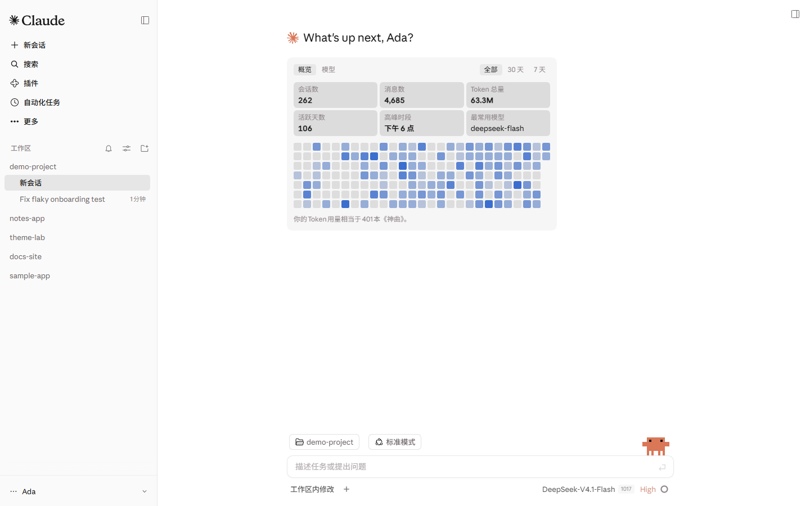</td>
    <td align="center" width="50%">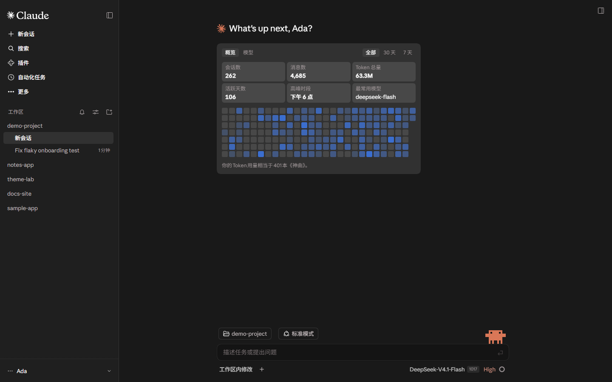</td>
  </tr>
  <tr>
    <td align="center" width="50%">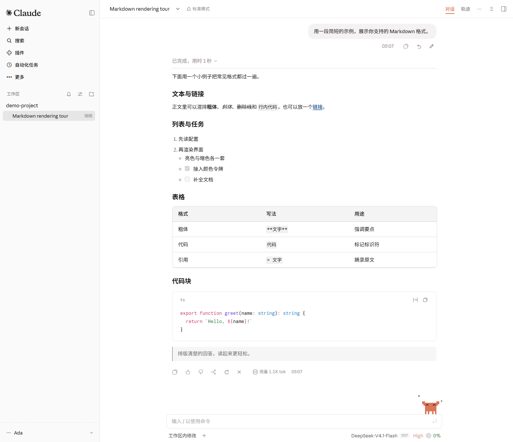</td>
    <td align="center" width="50%">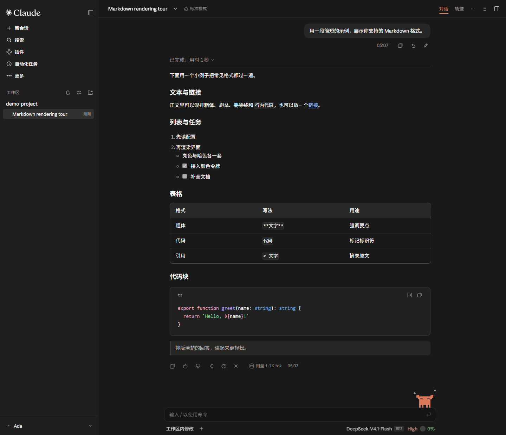</td>
  </tr>
</table>

> Code home above, conversation view below; light on the left, dark on the right.

### DeepSeek

<table>
  <tr>
    <td align="center" width="50%">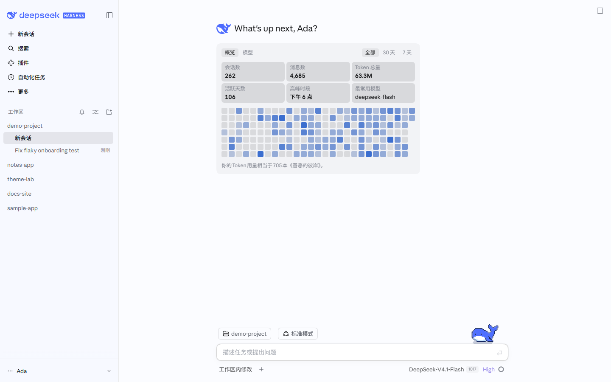</td>
    <td align="center" width="50%">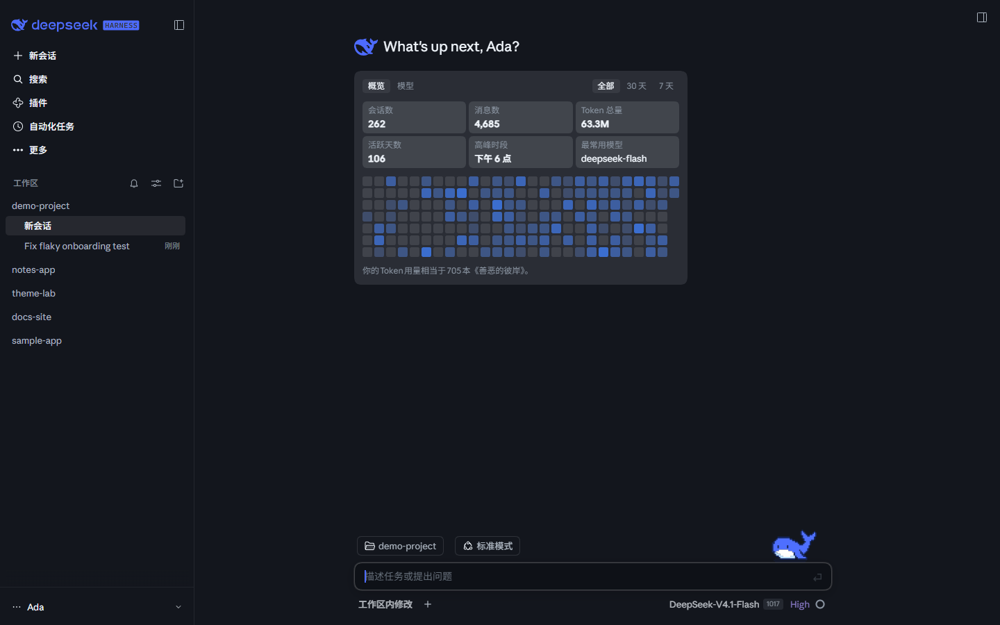</td>
  </tr>
  <tr>
    <td align="center" width="50%">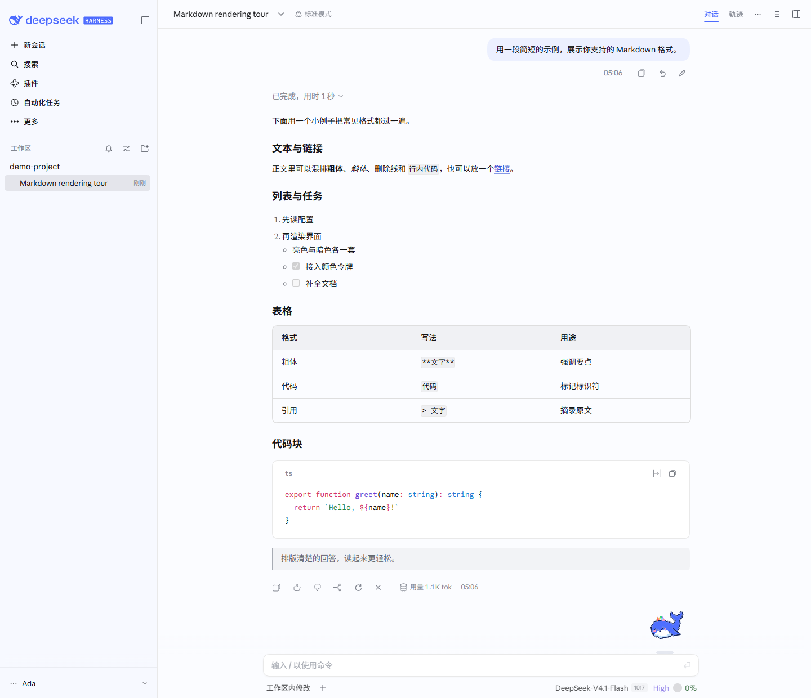</td>
    <td align="center" width="50%">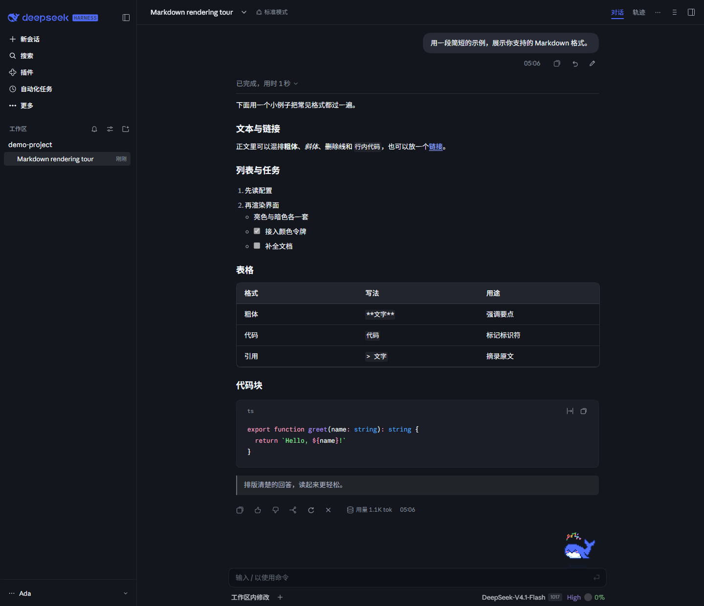</td>
  </tr>
</table>

> Deepy the pixel whale stands on the input box across eight states:

<table>
  <tr>
    <td align="center" width="25%"><br />Idle</td>
    <td align="center" width="25%"><br />Thinking</td>
    <td align="center" width="25%"><br />Answering and calling tools</td>
    <td align="center" width="25%">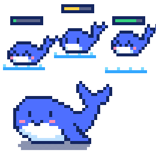<br />Conducting subagents</td>
  </tr>
  <tr>
    <td align="center" width="25%"><br />Waiting on you</td>
    <td align="center" width="25%">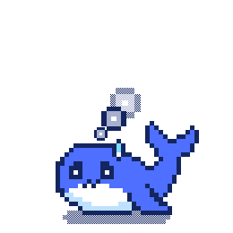<br />Failed</td>
    <td align="center" width="25%"><br />Finished</td>
    <td align="center" width="25%">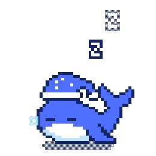<br />Asleep</td>
  </tr>
</table>

## Installation

Add the package name from the official Plugins page, or install from a terminal:

```
dsh-claude-style
```

```bash
dsh plugin --profile web add dsh-claude-style                    # npm package (recommended)
dsh plugin --profile web add Nwflower/dsh-claude-style#dist      # GitHub release branch
```

Also available from the [plugin market](https://github.com/dsh-market/dsh-market) or the Skin Center of dsh-web-all. Enable one theme at a time; dsh ≥ 0.2.2-rc.3 is required, and restart DeepSeek Harness after installing.

## Fonts

> Anthropic Sans, Anthropic Serif and Anthropic Mono have no public release; this repository only offers personal-study [copies](https://github.com/Nwflower/dsh-claude-style/tree/master/packages/assets/src/fonts/anthropic).

To enable them, install the `.ttf` files on your system, or copy them into `$DSH_HOME/dsh-claude-style/fonts/` and reload the page.

## Documentation

| Document | Contents |
| --- | --- |
| [Architecture](https://github.com/Nwflower/dsh-claude-style/blob/master/docs/ARCHITECTURE.md) | Repository layout, engine and half boundaries, cross-module invariants |
| [Design tokens](https://github.com/Nwflower/dsh-claude-style/blob/master/docs/STYLE.md) | Palette, typography, shape, motion and layer rules |
| [Architecture decisions](https://github.com/Nwflower/dsh-claude-style/blob/master/docs/adr/README.md) | One page per direction: background, decision, consequences, revisiting conditions |
| [Changelog](docs/CHANGELOG.md) | Version history |
| [Contributing](https://github.com/Nwflower/dsh-claude-style/blob/master/CONTRIBUTING.md) | Contribution flow and change-fragment format |

## License

Except where otherwise stated, this repository is licensed under MIT (see [LICENSE](LICENSE)).

The Sodium rendering engine is licensed under the [PolyForm Shield License 1.0.0](packages/client/src/features/sodium/LICENSE). Third-party code and asset notices are listed in [THIRD_PARTY_NOTICES.md](docs/THIRD_PARTY_NOTICES.md).

## Acknowledgements

- "Sodium" (钠) is named after Minecraft's [Sodium](https://github.com/CaffeineMC/sodium) rendering mod; this plugin is not affiliated with it.
- The message navigator follows SherUnlocked-4869's [dsh-plugin-msg-nav](https://github.com/SherUnlocked-4869/dsh-plugin-msg-nav) (MIT).
- The animation frames of Deepy the pixel whale come from the Deepy whale theme pack drawn by calmly-eating-bugs ([@wp3171216237](https://github.com/wp3171216237)), and ship with the plugin by the author's permission; GIFs of all 20 animations are in [docs/gifs/](https://github.com/Nwflower/dsh-claude-style/tree/master/docs/gifs).
- The whale girl pixel emoji set came with issue #224.
- The enhanced animations in the conversation area are modified from [dsh-chat-ux](https://github.com/alm-allen/dsh-chat-ux) (MIT).
- Clawd is a character of Anthropic. Its frames are not covered by the MIT license (see [LICENSE](LICENSE)). This plugin is an unofficial fan work, not affiliated with or endorsed by Anthropic.

## Related projects

> Want to import your Claude Code / Codex session history into DSH and keep the conversation going? Try [Nwflower/dsh-chat-import](https://github.com/Nwflower/dsh-chat-import).

## Star History

[](https://star-history.com/#Nwflower/dsh-claude-style&Date)
