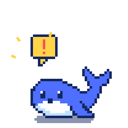
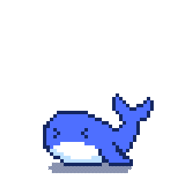

<div align="center">

# DSH Claude Style

**A theme plugin that brings the look and feel of Claude Code Desktop to the DeepSeek Harness Web GUI.**

> **Why settle for another Claude Code when your next Claude Code Desktop is here.**

[](README.en.md)
[](README.md)
[](https://www.npmjs.com/package/dsh-claude-style)
[](https://www.npmjs.com/package/dsh-claude-style)
[](https://github.com/Nwflower/dsh-claude-style)

</div>

## Preview

Switch between the Claude and DeepSeek brands in settings; light and dark follow the system. Appearance offers six colour presets — Claude, DeepSeek, Parchment, Forest, Dusk and Rose — lets you edit them, and lets you create, duplicate, rename and delete colour schemes.

### Claude

<table>
  <tr>
    <td align="center" width="50%"></td>
    <td align="center" width="50%"></td>
  </tr>
  <tr>
    <td align="center" width="50%"></td>
    <td align="center" width="50%"></td>
  </tr>
</table>

> Code home above, Markdown conversation below; light on the left, dark on the right.

### DeepSeek

<table>
  <tr>
    <td align="center" width="50%"></td>
    <td align="center" width="50%"></td>
  </tr>
  <tr>
    <td align="center" width="50%"></td>
    <td align="center" width="50%"></td>
  </tr>
</table>

> Deepy the pixel whale stands on the composer in eight states:

<table>
  <tr>
    <td align="center" width="25%"><br />Idle</td>
    <td align="center" width="25%"><br />Thinking</td>
    <td align="center" width="25%"><br />Answering and calling tools</td>
    <td align="center" width="25%"><br />Conducting subagents</td>
  </tr>
  <tr>
    <td align="center" width="25%"><br />Waiting on you</td>
    <td align="center" width="25%"><br />Failed</td>
    <td align="center" width="25%"><br />Finished</td>
    <td align="center" width="25%"><br />Asleep</td>
  </tr>
</table>

## Message rewind and revision history

Retract, edit, rerun and delete-turn open a confirmation dialog listing the turns leaving the current timeline and the files that can be restored. The conversation then continues from the original message position while the sidebar keeps presenting one logical conversation. Source sessions and later revisions move into the host archive and can be unarchived from **Revision history** in the message actions. Inherited-history dividers and fork-generated turn tails stay out of this continuous timeline.

The plugin records a workspace checkpoint for each turn and can restore code changes at the same time. History recorded before installation, or with an incomplete checkpoint, rewinds messages only and says so in the dialog. Git commits, external services and other command side effects are not undone.

## Installation

From the official plugin page add the package below, or from a terminal:

```
dsh-claude-style
```

```bash
dsh plugin --profile web add dsh-claude-style                    # npm package (recommended)
dsh plugin --profile web add Nwflower/dsh-claude-style#dist      # GitHub release branch
```

Also available from the [plugin market](https://github.com/dsh-market/dsh-market) or the Skin Center of dsh-web-all. Keep one theme enabled at a time; dsh ≥ 0.2.2-rc.1 is required, and restart DeepSeek Harness after installing.

The official DSH web and desktop frontends supply the browser module `@deepseek-ai/dsh-client-ui-primitives`. Profiles with pnpm’s `autoInstallPeers` disabled can use it without installing the package separately.

## Declarative appearance configuration

`paletteSchemes` and `brandingPresets` accept both nested YAML objects and the existing JSON-string records. This snippet shows plugin fields only, not a complete Harness profile:

```yaml
palette: claude
paletteColors: company-ocean
paletteSchemes:
  - id: company-ocean
    name: Company Ocean
    base: deepseek
    accent: "#2855d9"
    background:
      light: "#f7f9ff"
      dark: "#111827"
    code:
      light: "#173f99"
      dark: "#b8ceff"

brandingPreset: company-primary
brandingPresets:
  - id: company-primary
    name: Company Primary
    ink: original
    mark:
      light: "./branding/primary-mark-light.svg"
      dark: "./branding/primary-mark-dark.svg"
    wordmark: "./branding/primary-wordmark.svg"

modelOrder: custom
modelOrderRows:
  - deepseek-official/deepseek-v4.1-pro
  - sensenova/sensenova-6.8-flash
```

- Colour records use the five-seed model (`accent`, `background`, `text`, `code`, `link`) plus `edges`. The six built-in presets (`claude`, `deepseek`, `parchment`, `forest`, `dusk`, `rose`) and **Follow the brand** remain available.
- A logo preset has a stable `id`, an optional `name`, at least one of `mark` or `wordmark`, and an optional `ink` field (`original`, `accent` or `text`, defaulting to the original image colours). One string uses the same image in both appearances; a `light` / `dark` pair selects by appearance, with the supplied side covering a missing side.
- Relative image paths resolve from `$DSH_HOME/dsh-claude-style/` and must stay inside it. PNG, SVG and WebP files up to 2 MB are accepted. UI uploads live under `branding/presets/<id>/`, so switching presets needs no repeated upload.
- Appearance settings include eight built-in vendor presets (OpenAI, Gemini, Qwen, Kimi Code, ZCode, MiniMax, Grok, Xiaomi MiMo) and let you create, duplicate, rename, select and delete logo presets, replace light and dark images separately, and adjust logo colour. An empty `brandingPreset` follows the active theme's logo, and any earlier standalone global uploads are migrated into a **Current images** preset automatically. Logo and colour selections stay independent.
- UI edits persist in the plugin-managed `appearance-overlays.json` and merge with base YAML by `id`. UI-created or edited records and selection overrides win; records added later to the file are merged in, and base records deleted through the UI do not return after a reload. After a manual configuration edit and reload, unconflicted records follow the file, while conflicts follow the latest UI edit.
- Invalid records are reported and skipped without removing valid ones. A missing or invalid image affects only that image and leaves the other presets and settings UI working.
- `modelOrder` accepts `id`, `brand`, `catalog` and `custom`. Brand order places recognised vendors first and hides descriptions on unrecognised rows. Custom order follows `provider/model` entries in `modelOrderRows`; remaining models follow in ID order.

## Fonts

> The Anthropic fonts have no public release; this repository only offers [copies](https://github.com/Nwflower/dsh-claude-style/tree/master/packages/assets/src/fonts/anthropic) for download and study.

To enable them, install the `.ttf` files on your system, or copy them into `$DSH_HOME/dsh-claude-style/fonts/` (takes effect after a reload).

## Documentation

| Document | Contents |
| --- | --- |
| [Architecture](docs/ARCHITECTURE.md) | Repository layout, engine and half boundaries, cross-module invariants |
| [Design tokens](docs/STYLE.md) | The palette, typography, shape, motion and layer rules |
| [Architecture decisions](docs/adr/README.md) | One page per direction: background, decision, consequences, revisiting conditions |
| [Changelog](docs/CHANGELOG.md) | Version history |
| [Contributing](CONTRIBUTING.md) | Fix-first contribution flow and change-fragment format |

## License

Except where otherwise stated, this repository is licensed under MIT.

The Sodium rendering engine is licensed under the [PolyForm Shield License 1.0.0](packages/client/src/features/sodium/LICENSE).

## Acknowledgements

- "Sodium" (钠) is named after Minecraft's [Sodium](https://github.com/CaffeineMC/sodium) rendering mod; this plugin is not affiliated with it.
- The message navigator follows SherUnlocked-4869's [dsh-plugin-msg-nav](https://github.com/SherUnlocked-4869/dsh-plugin-msg-nav) (MIT).
- The animation frames of Deepy the pixel whale come from the Deepy whale theme pack drawn by calmly-eating-bugs ([@wp3171216237](https://github.com/wp3171216237)), and ship with the plugin by the author's permission; GIFs of all 20 animations are in [docs/gifs/](docs/gifs/).
- The whale girl pixel emoji set came with issue #224.
- The enhanced animations in the chat area are modified from [dsh-chat-ux](https://github.com/alm-allen/dsh-chat-ux) (MIT).
- Clawd is a character of Anthropic. Its frames are not covered by the MIT license (see [LICENSE](LICENSE)). This plugin is an unofficial fan work, not affiliated with or endorsed by Anthropic.

## Related projects

> Want to import your Claude Code / Codex session history into DSH and keep the conversation going? Try the author's other plugin, [dsh-chat-import](https://github.com/Nwflower/dsh-chat-import).

## Star History

[](https://star-history.com/#Nwflower/dsh-claude-style&Date)
