<div align="center">

# DSH Claude Style

**为 DeepSeek Harness 复刻 Claude Code Desktop 风格与交互体验的主题插件。**

> **你的下一个 Claude Code Desktop ，何必是Claude Code。**

[](README.md) [](README.en.md)

[](https://www.npmjs.com/package/dsh-claude-style)
[](https://www.npmjs.com/package/dsh-claude-style)
[](https://github.com/Nwflower/dsh-claude-style)
[](https://www.dsh.so/artifact/dsh-claude-style/)
[](LICENSE)

</div>

## 预览

两套主题在插件设置里切换，亮暗跟随系统。

### Claude

<table>
  <tr>
    <td align="center" width="50%">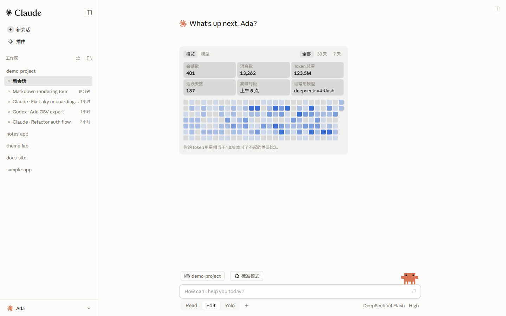</td>
    <td align="center" width="50%">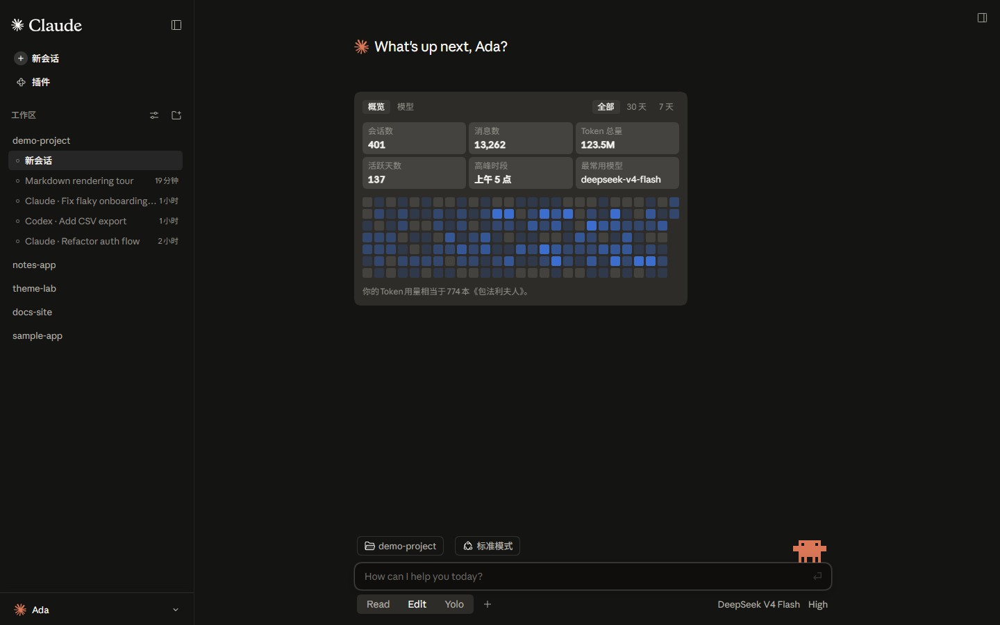</td>
  </tr>
  <tr>
    <td align="center" width="50%">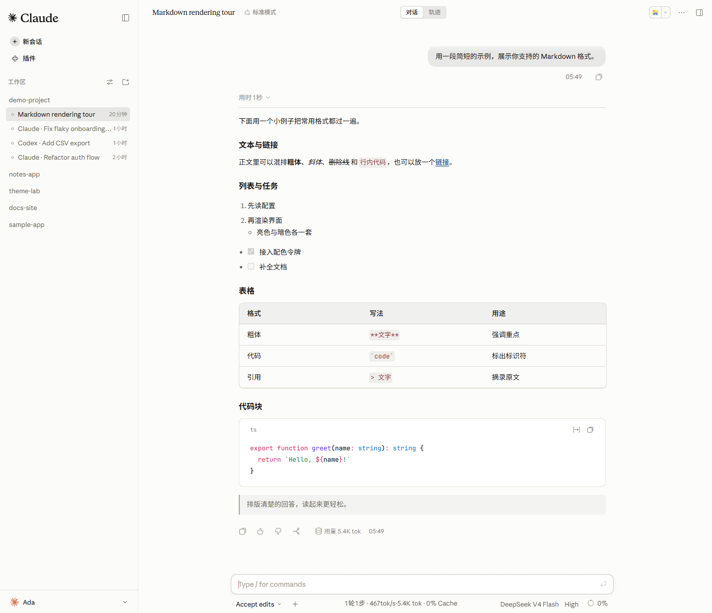</td>
    <td align="center" width="50%">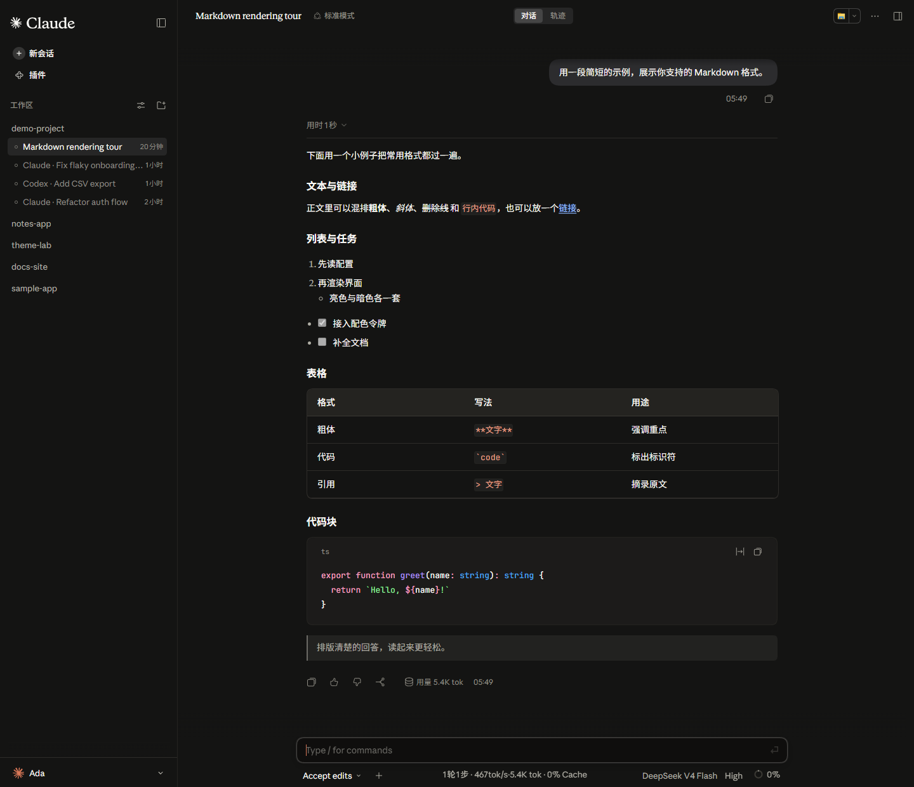</td>
  </tr>
</table>

> 编程首页（上），对话界面（下）；浅色在左，深色在右。

### DeepSeek

<table>
  <tr>
    <td align="center" width="50%">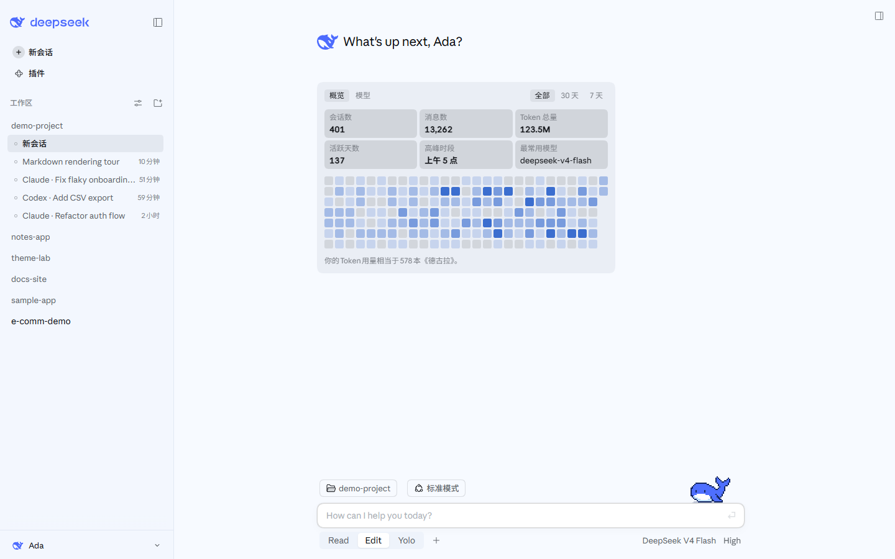</td>
    <td align="center" width="50%">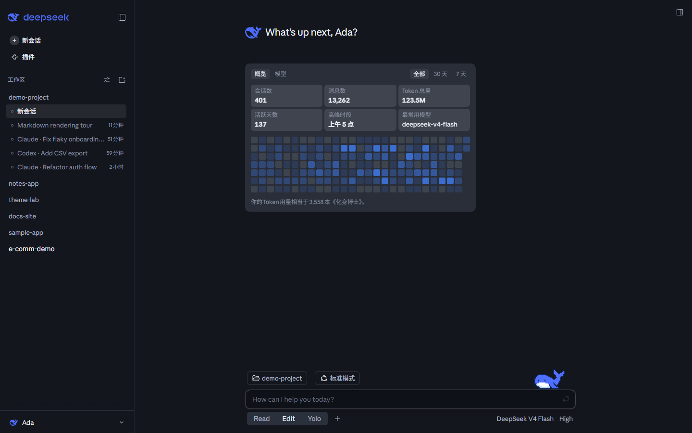</td>
  </tr>
  <tr>
    <td align="center" width="50%">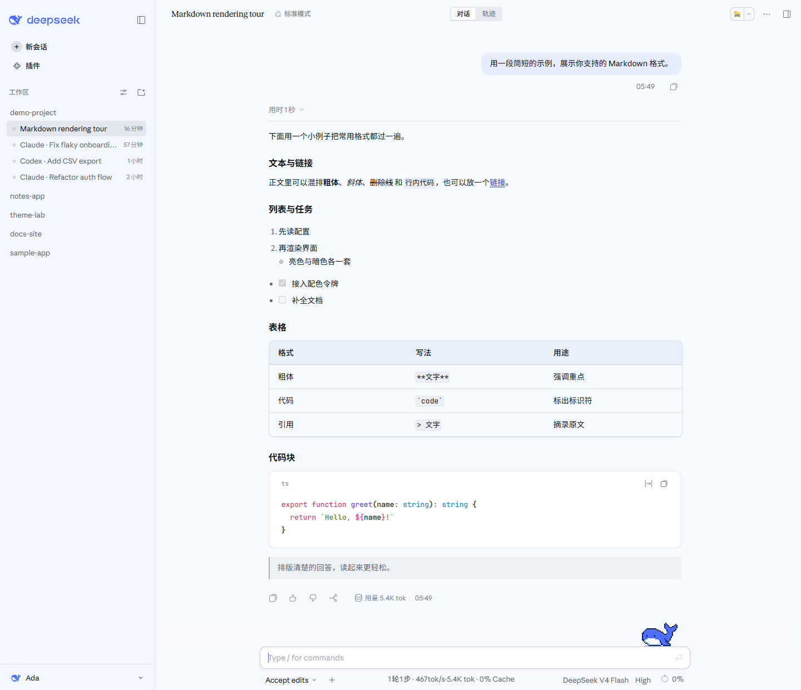</td>
    <td align="center" width="50%">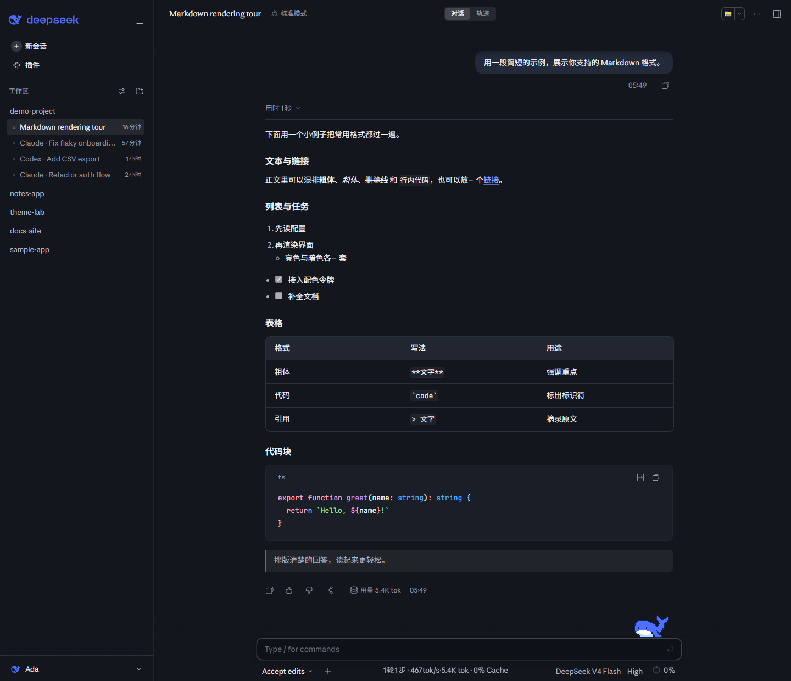</td>
  </tr>
</table>

> 输入框上沿站着宠物小鲸鱼 Deepy，八个状态：

<table>
  <tr>
    <td align="center" width="25%"><br />空闲</td>
    <td align="center" width="25%"><br />思考</td>
    <td align="center" width="25%">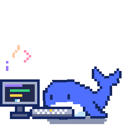<br />写回答、调用工具</td>
    <td align="center" width="25%">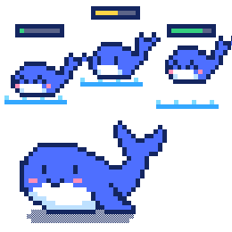<br />指挥子代理</td>
  </tr>
  <tr>
    <td align="center" width="25%">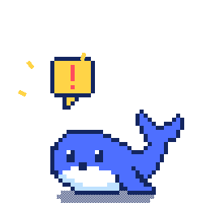<br />等你操作</td>
    <td align="center" width="25%">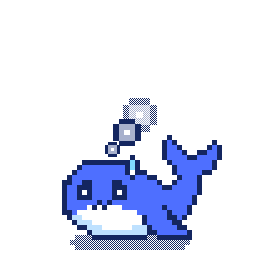<br />失败</td>
    <td align="center" width="25%">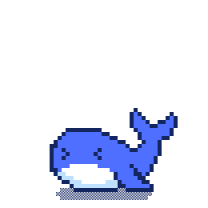<br />完成</td>
    <td align="center" width="25%">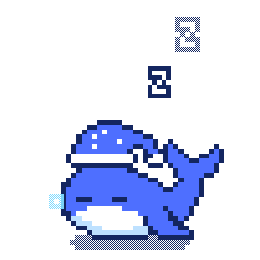<br />睡着</td>
  </tr>
</table>

> 吉祥物也可在设置里切换成像素螃蟹 Clawd 或像素鲸娘。

## 安装

官方插件页添加这个包名，或从终端安装：

```
dsh-claude-style
```

```bash
dsh plugin --profile web add dsh-claude-style                    # npm 包（推荐）
dsh plugin --profile web add Nwflower/dsh-claude-style#dist      # GitHub 发布分支
```

也可从[插件市场](https://github.com/dsh-market/dsh-market)或 dsh-web-all 的皮肤中心安装。同一时刻只启用一个主题；需要 dsh ≥ 0.2.2-rc.1，装好后重启 DeepSeek Harness。

## 手动未读标记

在会话的省略号菜单中选择「标记为未读」或「清除未读标记」。标记保存在当前配置中，刷新页面后保留，切走后再次打开该会话时清除；宿主的自动完成提醒保持独立。

## 撤回与编辑消息

指针移到你自己发出的消息上，时间与复制按钮旁边会多出「撤回」与「编辑」。两者都打开一个新会话，原会话原样保留：撤回把这条消息和它之后的对话切掉，把原文放回输入框等你重新发送；编辑先在气泡的位置改好文字，确认后直接在新会话里发出。带图片或文件附件的消息不给这两个按钮，附件没法随文字搬进新会话。这一轮还在进行时，两个按钮会先等它停下。可在插件设置的「对话」标签页关闭此功能。

## 字体

> Anthropic 没有公开发行这三款字体；本仓库只提供下载与研究的[副本](https://github.com/Nwflower/dsh-claude-style/tree/master/packages/assets/src/fonts/anthropic)。


启用时二选一：装进系统，或把 `.ttf` 复制到 `$DSH_HOME/dsh-claude-style/fonts/`。

## 文档

| 文档 | 说明 |
| --- | --- |
| [设计令牌](docs/STYLE.md) | 配色、字体、形状、动效与层级 |
| [架构决策](docs/adr/README.md) | 每条方向一页：背景、决定、后果与重审条件 |
| [更新日志](docs/CHANGELOG.md) | 版本历史 |
| [贡献指南](CONTRIBUTING.md) | 构建、提交规范与回归工具 |

## 许可

除特别说明，本仓库以 MIT 授权。

钠（Sodium）渲染引擎以 [PolyForm Shield 1.0.0](packages/client/src/features/sodium/LICENSE) 授权。

## 鸣谢

- 「钠 / Sodium」取名自 Minecraft 的 [Sodium](https://github.com/CaffeineMC/sodium) 渲染优化模组，本插件与它没有关联。
- 消息导航参考 SherUnlocked-4869 的 [dsh-plugin-msg-nav](https://github.com/SherUnlocked-4869/dsh-plugin-msg-nav)（MIT）。
- Deepy 和鲸鱼娘的动画帧图来自 calmly-eating-bugs（[@wp3171216237](https://github.com/wp3171216237)）绘制的主题包。
- 聊天区的增强动效改自 [dsh-chat-ux](https://github.com/alm-allen/dsh-chat-ux)（MIT）。
- Clawd是 Anthropic 的角色形象。帧图不适用 MIT 许可（见 [LICENSE](LICENSE)）。本插件是非官方爱好者作品，与 Anthropic 没有关联。

## 友链

> 想把 Claude Code / Codex 等外部代理的会话历史导入 DSH 接着聊？推荐作者的另一个插件 [dsh-chat-import](https://github.com/Nwflower/dsh-chat-import)。

## Star History

[](https://star-history.com/#Nwflower/dsh-claude-style&Date)
