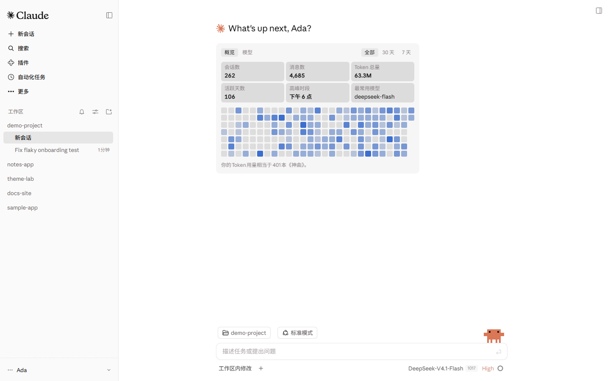
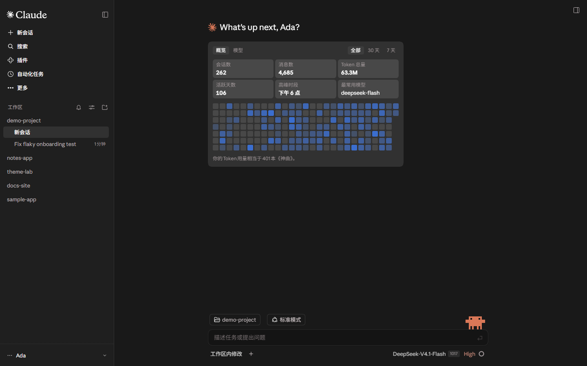
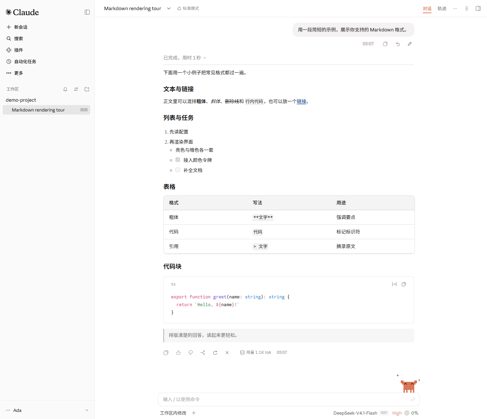
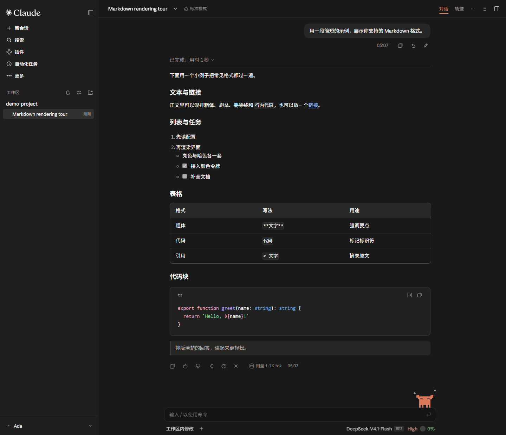
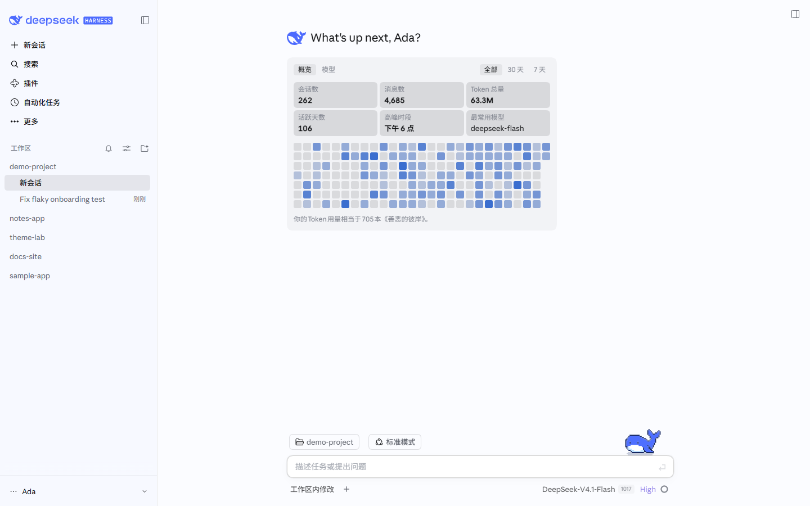
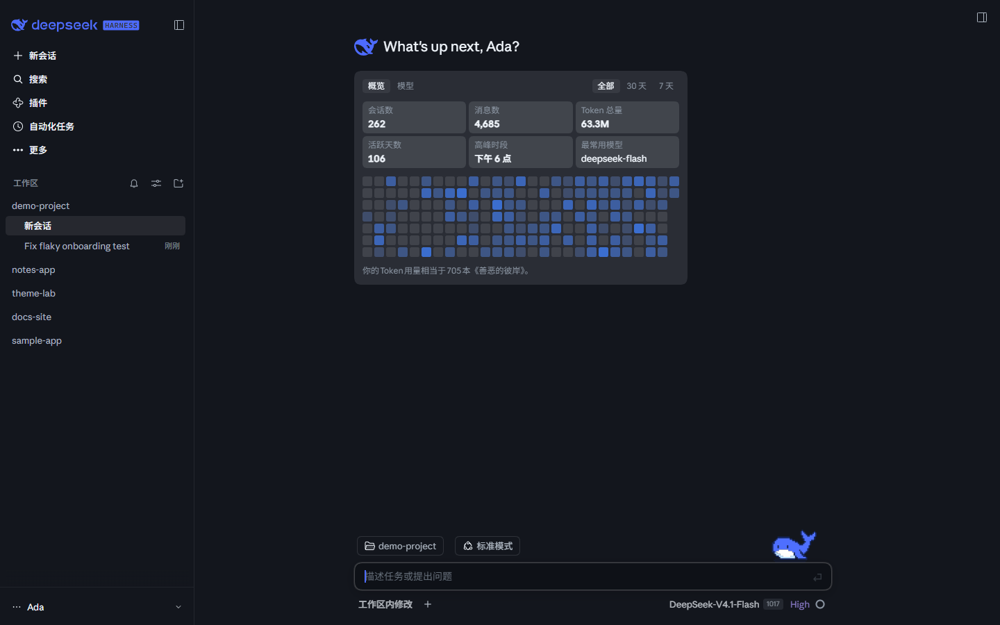
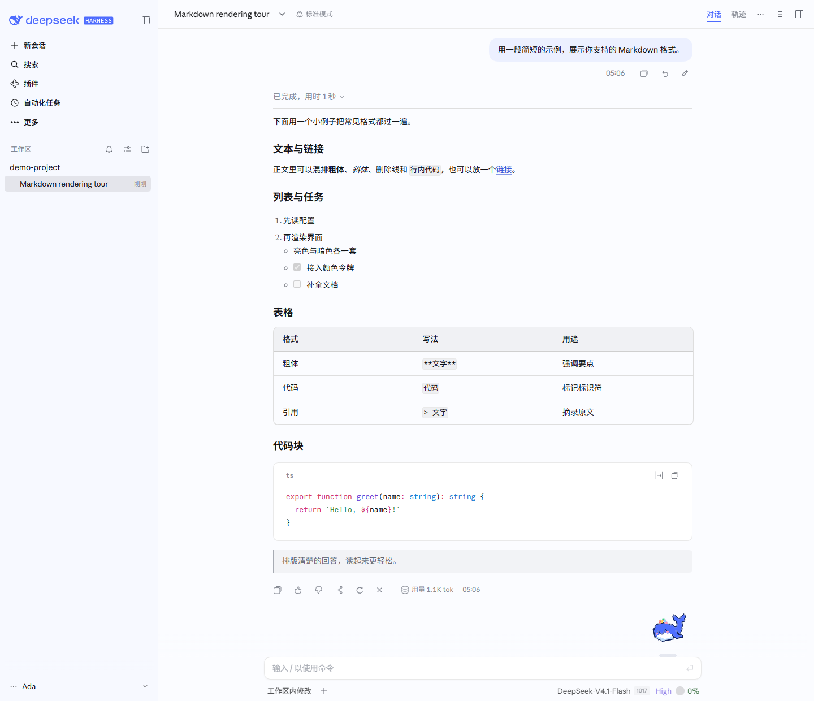
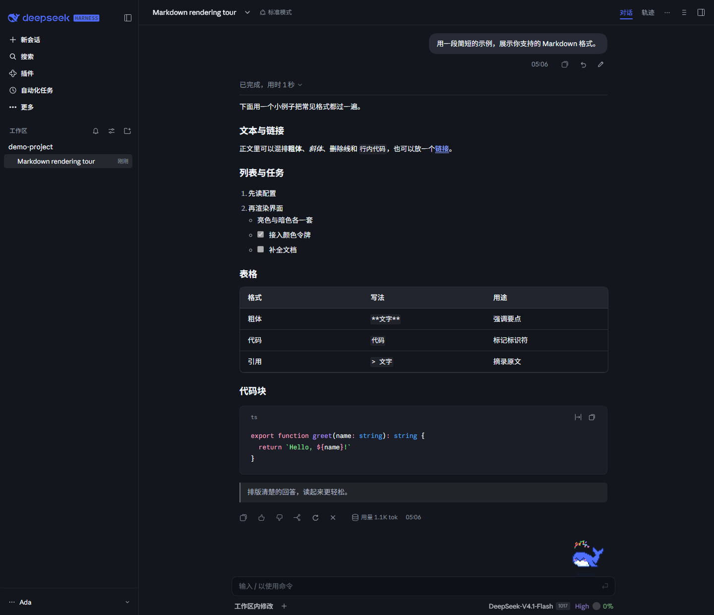
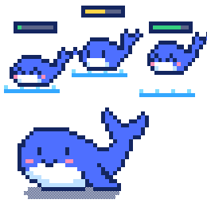
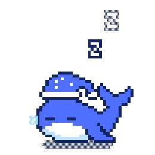

<div align="center">

# DSH Claude Style

**为 DeepSeek Harness 复刻 Claude Code Desktop 风格与交互体验的主题插件。**

> **你的下一个 Claude Code Desktop，何必是 Claude Code。**

[](README.md)
[](README.en.md)
[](https://www.npmjs.com/package/dsh-claude-style)
[](https://www.npmjs.com/package/dsh-claude-style)
[](https://github.com/Nwflower/dsh-claude-style)

</div>

## 预览

在插件设置的「主题风格」中切换 Claude 与 DeepSeek 风格，明暗外观跟随系统。外观设置内置 Claude、DeepSeek、羊皮纸、森林、暮色、蔷薇六套配色预设，支持修改预设，或新建、复制、重命名与删除配色方案。

### Claude

<table>
  <tr>
    <td align="center" width="50%"></td>
    <td align="center" width="50%"></td>
  </tr>
  <tr>
    <td align="center" width="50%"></td>
    <td align="center" width="50%"></td>
  </tr>
</table>

> 编程首页（上），对话界面（下）；浅色在左，深色在右。

### DeepSeek

<table>
  <tr>
    <td align="center" width="50%"></td>
    <td align="center" width="50%"></td>
  </tr>
  <tr>
    <td align="center" width="50%"></td>
    <td align="center" width="50%"></td>
  </tr>
</table>

> 输入框上沿站着像素小鲸鱼 Deepy，涵盖八种状态：

<table>
  <tr>
    <td align="center" width="25%"><br />空闲</td>
    <td align="center" width="25%"><br />思考</td>
    <td align="center" width="25%"><br />写回答、调用工具</td>
    <td align="center" width="25%"><br />指挥子代理</td>
  </tr>
  <tr>
    <td align="center" width="25%"><br />等你操作</td>
    <td align="center" width="25%"><br />失败</td>
    <td align="center" width="25%"><br />完成</td>
  <td align="center" width="25%"><br />睡着</td>
  </tr>
</table>

## 安装

在官方插件页添加包名，或通过终端安装：

```
dsh-claude-style
```

```bash
dsh plugin --profile web add dsh-claude-style                    # npm 包（推荐）
dsh plugin --profile web add Nwflower/dsh-claude-style#dist      # GitHub 发布分支
```

也可从[插件市场](https://github.com/dsh-market/dsh-market)或 dsh-web-all 皮肤中心安装。同一时刻只启用一个主题；需要 dsh ≥ 0.2.2-rc.3，安装后重启 DeepSeek Harness。

## 字体

> Anthropic Sans、Anthropic Serif 与 Anthropic Mono 未公开发行；本仓库仅提供仅供个人研究使用的[副本](https://github.com/Nwflower/dsh-claude-style/tree/master/packages/assets/src/fonts/anthropic)。

启用方式二选一：安装进操作系统，或将 `.ttf` 文件复制到 `$DSH_HOME/dsh-claude-style/fonts/` 后刷新页面。

## 文档

| 文档 | 说明 |
| --- | --- |
| [架构](https://github.com/Nwflower/dsh-claude-style/blob/master/docs/ARCHITECTURE.md) | 仓库结构、引擎与两半边边界、跨模块不变量 |
| [设计令牌](https://github.com/Nwflower/dsh-claude-style/blob/master/docs/STYLE.md) | 配色、字体、形状、动效与层级规则 |
| [架构决策](https://github.com/Nwflower/dsh-claude-style/blob/master/docs/adr/README.md) | 方向性决策记录：背景、决定、后果与重审条件 |
| [更新日志](docs/CHANGELOG.md) | 版本历史 |
| [贡献指南](https://github.com/Nwflower/dsh-claude-style/blob/master/CONTRIBUTING.md) | 贡献流程与变更记录格式 |

## 许可

除特别说明，本仓库以 MIT 授权（见 [LICENSE](LICENSE)）。

钠（Sodium）渲染引擎以 [PolyForm Shield 1.0.0](packages/client/src/features/sodium/LICENSE) 授权。第三方代码与资源许可见 [THIRD_PARTY_NOTICES.md](docs/THIRD_PARTY_NOTICES.md)。

## 鸣谢

- 「钠 / Sodium」取名致敬 Minecraft 的 [Sodium](https://github.com/CaffeineMC/sodium) 渲染优化模组，本插件与它无关。
- 消息导航参考 SherUnlocked-4869 的 [dsh-plugin-msg-nav](https://github.com/SherUnlocked-4869/dsh-plugin-msg-nav)（MIT）。
- Deepy 小鲸鱼的动画帧图来自 calmly-eating-bugs（[@wp3171216237](https://github.com/wp3171216237)）绘制的主题包，经作者授权随插件发布；全部 20 个动画的 GIF 见 [docs/gifs/](https://github.com/Nwflower/dsh-claude-style/tree/master/docs/gifs)。
- 鲸娘像素表情来自 issue #224。
- 对话区的增强动效改自 [dsh-chat-ux](https://github.com/alm-allen/dsh-chat-ux)（MIT）。
- Clawd 是 Anthropic 的角色形象，其帧图不在 MIT 许可范围内（见 [LICENSE](LICENSE)）。本插件是非官方爱好者作品，与 Anthropic 没有关联。

## 友链

> 想把 Claude Code / Codex 等外部代理的会话历史导入 DSH 接着聊？推荐作者的另一个插件 [dsh-chat-import](https://github.com/Nwflower/dsh-claude-style/blob/master/README.md#友链) — [Nwflower/dsh-chat-import](https://github.com/Nwflower/dsh-chat-import)。

## Star History

[](https://star-history.com/#Nwflower/dsh-claude-style&Date)
